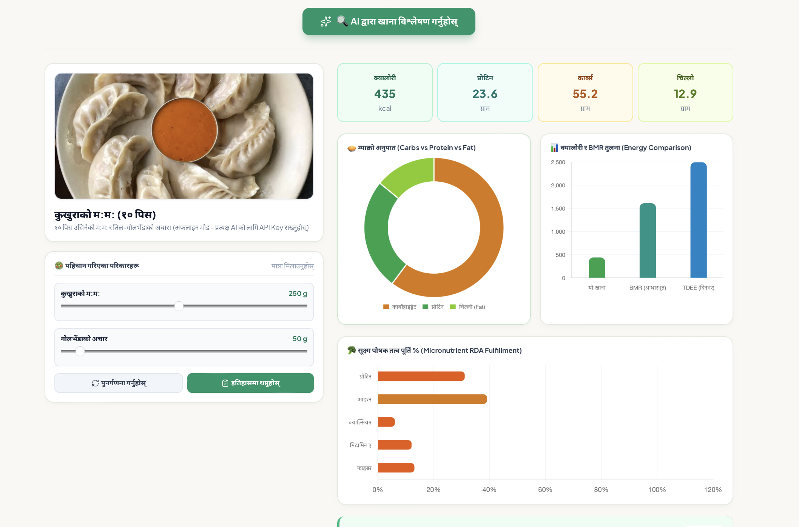

# 🇳🇵 Khana-AI  — Open-Source Nepali Nutrition

**KhanaAI** is an open-source health and nutrition web platform tailored for traditional Nepali diets and South Asian health metrics. It calculates personalized calorie requirements from user profile data, evaluates meal nutritional balance, features a weekly meal planner, exports printable health reports for doctors, and includes a bilingual AI chatbot for diet queries.

---

## 📸 Demo


*AI Food Scanner analyzing a plate of Chicken Momo to estimate portion sizes, calories, and macronutrient balance.*

🌐 **Live Web Application:** [https://khana-ai.onrender.com/](https://khana-ai.onrender.com/)

---

## ✨ Key Features

- **📊 South Asian Health Metrics:** Calculates South Asian BMI, Basal Metabolic Rate (BMR), Total Daily Energy Expenditure (TDEE), and daily protein targets based on age, height, and weight.
- **🍛 Food & Calorie Tracking:** Estimates calories, protein, and macro balance from logged food items.
- **⚖️ Plate Balance Evaluation:** Analyzes diet history to highlight whether daily calorie and protein consumption is target-matched, undershot, or overshot.
- **📅 Meal Planner (`खाना तालिका`):** Features a weekly calorie budget planner with target vs. actual consumption breakdown.
- **📄 Doctor PDF Report (`डाक्टर PDF रिपोर्ट`):** Exports a comprehensive nutrition and health summary into a printable PDF report for medical consultations.
- **🤖 Poshan Sathi AI Chatbot (`पोषण साथी AI`):** An interactive assistant to answer questions about food, diet, recipes, and nutrition.
- **🇳🇵 Bilingual Support (Nepali & English):** Instant language toggling across the interface.
- **📖 Local Knowledgebase (`रैथाने ज्ञानकोष`):** Integrated database on local Nepali dishes and their nutritional breakdown.

---

## 📁 Repository Structure

```text
Khana-AI/
├── core/                  # BMR calculator, vision engine, and nutrition DB
├── data/                  # Local datasets (nepali_foods.json, diet_history.db)[cite: 3]
├── docs/assets/           # Screenshots and demo media[cite: 3]
├── src/poshan_ai/        # Core application modules[cite: 3]
├── static/                # Web assets and styles[cite: 3]
├── tests/                 # Unit testing suites[cite: 3]
├── app.py                 # Streamlit web frontend entry point[cite: 3]
├── server.py              # Backend API server[cite: 3]
└── requirements.txt       # Python dependencies[cite: 3]